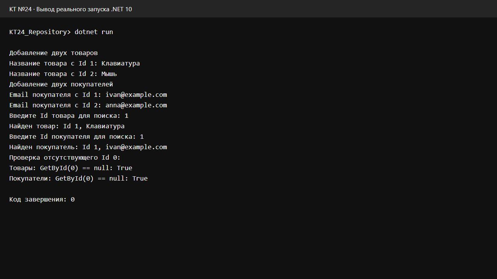
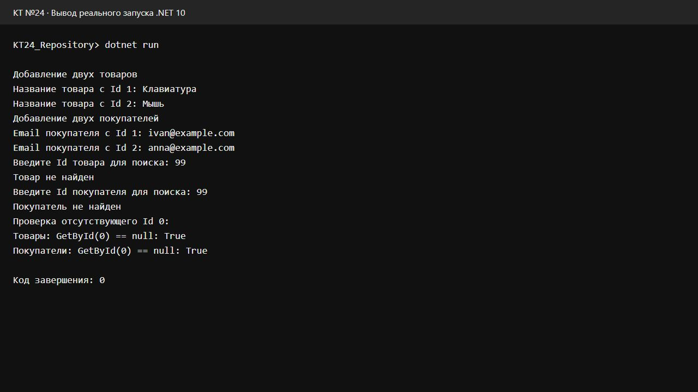

# КТ №24. Ограниченные классы

Вариант 1 — «Репозиторий сущностей».

## Что делает программа

Программа хранит товары и покупателей в двух отдельных репозиториях. Я ввожу названия двух товаров и email двух покупателей с клавиатуры. В каждом репозитории элементы получают Id 1 и 2.

После ввода можно найти товар и покупателя по Id. Если такого элемента нет, программа пишет, что он не найден. В конце отдельно проверяется отсутствующий Id 0: оба вызова GetById возвращают null, поэтому проверки выводят True.

Данные хранятся в памяти только до завершения программы.

## Как устроен проект

- Entity.cs — базовый класс со свойством Id.
- Product.cs — товар, наследует Entity и добавляет Name.
- Customer.cs — покупатель, наследует Entity и добавляет Email.
- Repository.cs — обобщённый класс с методами Add и GetById.
- Program.cs — ввод данных и проверка поиска.

Ограничение `where T : Entity` разрешает использовать только Entity и его наследников. Благодаря этому в GetById можно обращаться к `item.Id` напрямую, без приведения типов. Один класс Repository работает и с Product, и с Customer, а списки у них отдельные.

`Add` добавляет элемент в список. `GetById` перебирает список, возвращает элемент с нужным Id или null, если ничего не найдено. `init` позволяет задать Id при создании объекта.

## Проверка запуска

Сборка прошла без ошибок и предупреждений. Ниже скриншоты окна проверки в браузере с реальным выводом запущенной консольной программы и введёнными строками.

Поиск существующего Id в обоих репозиториях:

Поиск отсутствующего Id в обоих репозиториях:

